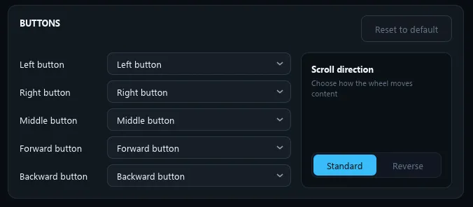
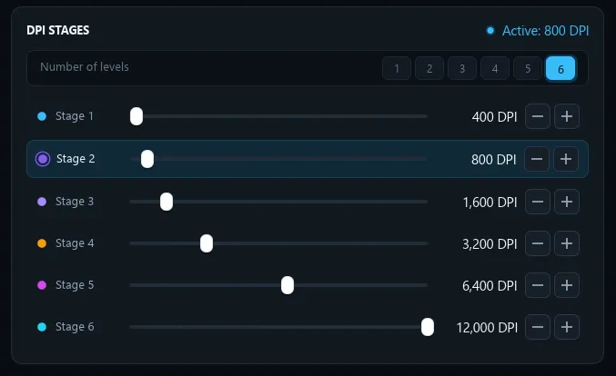

# M-RustHub 🖱️

**A lightweight, open-source native alternative to the official MCHOSE HUB (M-HUB) software & driver for MCHOSE G3 V2.**

Zero Electron. Zero Chinese cloud telemetry. 100% offline and instant.

[](https://github.com/hadoooooouken/M-RustHub/releases/latest)
[](https://github.com/hadoooooouken/M-RustHub/releases/latest)
[](LICENSE)

> 📥 **[Download Latest Release](https://github.com/hadoooooouken/M-RustHub/releases/latest)** | 📦 **[All Releases](https://github.com/hadoooooouken/M-RustHub/releases)**

---

<p align="center">
  
</p>

---

## ⚡ Open-Source Alternative to MCHOSE HUB

M-RustHub was built as a fast, privacy-focused replacement for the official **MCHOSE HUB** (M-HUB) mouse software and web driver.

| Feature | Official MCHOSE HUB Client | M-RustHub (This App) |
| :--- | :--- | :--- |
| **Technology** | Electron + WebView (Next.js) | Native Rust (`eframe` / `egui` + `hidapi`) |
| **Binary Size** | ~250 MB | **~6.5 MB** |
| **RAM Usage** | High (Chromium / Electron runtime) | **Minimal (lightweight native app)** |
| **Startup Time** | Multi-second delay (loads web engine) | **Instant** |
| **Offline Capability** | ❌ Fails when Chinese CDN is down | **✅ 100% Offline (No Internet needed)** |
| **CLI / Automation** | ❌ No | **✅ Full CLI support (hotkeys/scripts)** |

---

## 🚀 Usage

### 1. Graphical User Interface (GUI)
Simply run or double-click `m_rusthub.exe`:
```powershell
.\m_rusthub.exe
# or
.\m_rusthub.exe gui
```

Features available in GUI:
- **Live Battery Indicator** (Percentage & Charging status)
- **Button Remapping**: Expandable **Remap** drawer to reassign all 5 physical buttons (Left, Right, Middle, Forward, Backward) with dedicated actions, adjust scroll direction, and reset to defaults

<p align="center">
  
</p>

- **Number of Levels selector (1 to 6)** — customize exactly how many DPI stages are active
- **DPI customizer** (100 – 12,000 DPI) with interactive sliders and quick ±100 buttons

<p align="center">
  
</p>

- **Polling Rate selector** (125 Hz, 250 Hz, 500 Hz, 1000 Hz)
- **Button Debounce Time**: 0 ms – 20 ms (anti-doubleclick tuning)
- **Wireless Sleep Timeout**: 0 min – 100 min (0 = Never sleep)
- **Instant Save to Flash** (Hardware memory)
- **Factory Reset**: Hold <kbd>Shift</kbd> while hovering over the **Restore from mouse** button to reveal **Factory reset**

---

### 2. Command Line Interface (CLI)

> [!NOTE]
> `m_rusthub.exe` is a GUI-subsystem binary, so the shell does not wait for it: output may appear after the next prompt, and the exit code is not reported. When you need to read the output or check the exit code, make the shell wait:
> ```powershell
> .\m_rusthub.exe status | Out-Host     # PowerShell
> start /wait m_rusthub.exe status      # cmd (exit code in %ERRORLEVEL%)
> ```
> Hotkey tools (AutoHotkey, shortcuts, Task Scheduler) are unaffected.

#### View current status & telemetry:
```powershell
.\m_rusthub.exe status
```

#### Set number of active DPI levels (1 to 6):
```powershell
.\m_rusthub.exe set-levels 2
```

#### Change Polling Rate (125, 250, 500, 1000 Hz):
```powershell
.\m_rusthub.exe set-rate 1000
.\m_rusthub.exe set-rate 500
```

#### Switch active DPI stage:
```powershell
.\m_rusthub.exe set-stage 2
```

#### Change DPI value (100 to 12000 DPI, step 100):
```powershell
# Set current stage to 1600 DPI:
.\m_rusthub.exe set-dpi 1600

# Set Stage #1 specifically to 800 DPI:
.\m_rusthub.exe set-dpi 800 --stage 1
```

#### Set button debounce time:
```powershell
.\m_rusthub.exe set-debounce 4
```

#### Set wireless sleep timeout:
```powershell
.\m_rusthub.exe set-sleep 5
# Disable sleep (Never sleep):
.\m_rusthub.exe set-sleep 0
```

#### Remap mouse buttons:
```powershell
# Syntax: set-button <1-5> <action>
# Buttons: 2 = Right, 3 = Middle, 4 = Forward, 5 = Backward
# Actions: left, right, middle, forward, backward, disabled

# Swap Forward and Backward buttons:
.\m_rusthub.exe set-button 4 backward
.\m_rusthub.exe set-button 5 forward

# Make the Right button act as a second Left click:
.\m_rusthub.exe set-button 2 left
```

> [!NOTE]
> Button 1 (Left) cannot be remapped: the mouse firmware ignores changes to it, and the official MCHOSE driver blocks it as well.

---

## 🛠️ Building Clean Release

You can build a clean release binary (without any compiler artifacts) using either script:

- **1-Click (Explorer/CMD):** Double-click [`build.bat`](file:///e:/m_rusthub/build.bat)
- **PowerShell:**
  ```powershell
  .\build.ps1
  # or with tests before build:
  .\build.ps1 -Test
  ```

The clean standalone executable will be placed directly in:
`release\m_rusthub.exe`

---

## 📄 License

This project is open-source and available under the [MIT License](LICENSE).

---

## ⚠️ Disclaimer

This software is provided "as is", without warranty of any kind, express or implied. The author and contributors assume no liability for any direct, indirect, incidental, or consequential damages, hardware malfunction, or loss of data resulting from the use of this tool. Use at your own risk.
