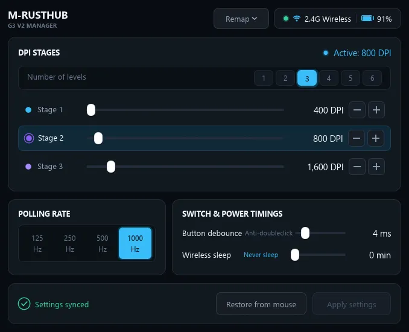

# M-RustHub 🖱️

Native, lightweight Rust configuration utility for **MCHOSE G3 V2**.

Zero Electron. Zero Chinese cloud telemetry. 100% offline and instant.

[](https://github.com/hadoooooouken/M-RustHub/releases/latest)
[](https://github.com/hadoooooouken/M-RustHub/releases/latest)
[](LICENSE)

> 📥 **[Download Latest Release](https://github.com/hadoooooouken/M-RustHub/releases/latest)** | 📦 **[All Releases](https://github.com/hadoooooouken/M-RustHub/releases)**

---

<p align="center">
  
</p>

---

## ⚡ Comparison with Official M HUB Client

| Feature | Official M HUB Client | M-RustHub (This App) |
| :--- | :--- | :--- |
| **Technology** | Electron + WebView (Next.js) | Native Rust (`eframe` / `egui` + `hidapi`) |
| **Binary Size** | ~250 MB | **~6.5 MB** |
| **RAM Usage** | High (Chromium / Electron runtime) | **Minimal (lightweight native app)** |
| **Startup Time** | Multi-second delay (loads web engine) | **Instant** |
| **Offline Capability** | ❌ Fails when Chinese CDN is down | **✅ 100% Offline (No Internet needed)** |
| **CLI / Automation** | ❌ No | **✅ Full CLI support (hotkeys/scripts)** |

---

## 🚀 Usage

### 1. Graphical User Interface (GUI)
Simply run or double-click `m_rusthub.exe`:
```powershell
.\m_rusthub.exe
# or
.\m_rusthub.exe gui
```

Features available in GUI:
- **Live Battery Indicator** (Percentage & Charging status)
- **Number of Levels selector (1 to 6)** — customize exactly how many DPI stages are active
- **DPI customizer** (100 – 12,000 DPI) with interactive sliders and quick ±100 buttons
- **Polling Rate selector** (125 Hz, 250 Hz, 500 Hz, 1000 Hz)
- **Button Debounce Time**: 0 ms – 20 ms (anti-doubleclick tuning)
- **Wireless Sleep Timeout**: 0 min – 100 min (0 = Never sleep)
- **Instant Save to Flash** (Hardware memory)
- **Factory Reset**: Hold <kbd>Shift</kbd> while hovering over the **Restore from mouse** button to reveal **Factory reset**

---

### 2. Command Line Interface (CLI)

#### View current status & telemetry:
```powershell
.\m_rusthub.exe status
```

#### Set number of active DPI levels (1 to 6):
```powershell
.\m_rusthub.exe set-levels 2
```

#### Change Polling Rate (125, 250, 500, 1000 Hz):
```powershell
.\m_rusthub.exe set-rate 1000
.\m_rusthub.exe set-rate 500
```

#### Switch active DPI stage:
```powershell
.\m_rusthub.exe set-stage 2
```

#### Change DPI value (100 to 12000 DPI, step 100):
```powershell
# Set current stage to 1600 DPI:
.\m_rusthub.exe set-dpi 1600

# Set Stage #1 specifically to 800 DPI:
.\m_rusthub.exe set-dpi 800 --stage 1
```

#### Set button debounce time:
```powershell
.\m_rusthub.exe set-debounce 4
```

#### Set wireless sleep timeout:
```powershell
.\m_rusthub.exe set-sleep 5
# Disable sleep (Never sleep):
.\m_rusthub.exe set-sleep 0
```

---

## 🛠️ Building Clean Release

You can build a clean release binary (without any compiler artifacts) using either script:

- **1-Click (Explorer/CMD):** Double-click [`build.bat`](file:///e:/m_rusthub/build.bat)
- **PowerShell:**
  ```powershell
  .\build.ps1
  # or with tests before build:
  .\build.ps1 -Test
  ```

The clean standalone executable will be placed directly in:
`release\m_rusthub.exe`

---

## 📄 License

This project is open-source and available under the [MIT License](LICENSE).
